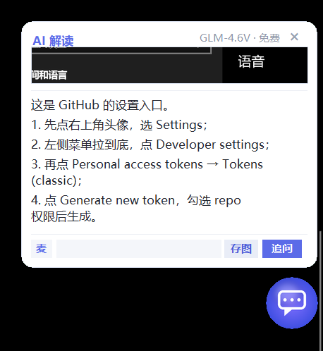

# AI 桌面小工具集

三个给 Windows 用的 AI 小工具：两个「贴在屏幕边上、按一下就干活」的挂件，加一个把 7 家大模型装进同一个界面的桌面客户端。

| 工具 | 干什么 | 联网 | 目录 |
| --- | --- | --- | --- |
| **便携翻译** | 框选屏幕上的英文 → 本地 OCR → 本地神经翻译，全程离线 | 只有首次下载模型时联网 | [`offline-translator/`](offline-translator/) |
| **APL 视觉模型**（豆包截图挂件） | 点一下框选屏幕 → 自动发给视觉大模型 → 答案从挂件上方弹出 | 框选松手那一刻才上传那一小块图 | [`doubao-screenshot-widget/`](doubao-screenshot-widget/) |
| **AI 聚合助手** | 豆包 / DeepSeek / 千问 / Kimi / 智谱 / ChatGPT 一个界面用遍，独立窗口 + 托盘 + 全局热键 | 聊天时才联网，Key 只存本机 | [`ai-hub/`](ai-hub/) |

---

## 1. 便携翻译 · offline-translator

纯本地的 Windows 取词翻译：截屏框选 → 系统 OCR → CTranslate2 神经翻译（en→zh），**不调用任何在线接口、不消耗任何 AI 额度**。

- `Alt+T` 唤起框选，`Ctrl+Alt+C` 直接翻剪贴板
- 圆形悬浮球 / 横条悬浮条，右键随时切换
- 界面米黄 + 浅绿 + 深绿，浅色简约风

👉 详细用法、技术栈、实测性能、目录结构见 [offline-translator/README.md](offline-translator/README.md)

> 打包后的完整程序约 547MB（含 Qt 运行时 + 模型），超过 GitHub 单文件 100MB 限制，所以仓库里只放源码 + 模型，需要 exe 按 README 第三节用 PyInstaller 自行打包。

## 2. APL 视觉模型 · doubao-screenshot-widget

一个紫色圆球挂件：点一下就能框选屏幕任何位置，自动发给免费视觉模型（智谱 `GLM-4.6V-Flash`，官方标注输入输出全免费），答案从圆球上方的小卡片弹出来。不用切窗口、不用复制粘贴。

- 单击圆球 → 拖框 → 松手即出答案；`Ctrl+Alt+Q` 老板键
- 平时缩成半圆贴边，鼠标靠近才展开
- 卡片里可以继续追问，AI 记得这张图
- 自带「存图」、听写按钮、把截图另存为原分辨率 PNG

👉 首次使用（拿 API Key、填 Key、自检命令）见 [doubao-screenshot-widget/README.md](doubao-screenshot-widget/README.md)

⚠️ 仓库里的 `config.json` 已经把 `api_key` 清空了，首次运行请自行填自己的 Key，不要把自己用的 Key 提交上来。

---

## 3. AI 聚合助手 · ai-hub

把 7 家大模型装进同一个界面的桌面客户端。左侧是各家官方图标，点一下 → 填自己的官方 API Key → 就在同一个窗口里聊天。

- **独立窗口**（Edge WebView2 内核，不是浏览器标签），`Ctrl+Alt+Space` 全局热键随时唤出
- **关窗口只进托盘**，托盘菜单可显示/重载/在浏览器打开/重启服务/退出
- 单模型对话、**多模型并行对比 + 一键汇总**、多模型接力工作流、技能库、历史记录
- **语音输入**（第三方 ASR 边说边出字，或浏览器自带识别）、**朗读**（edge-tts 本地合成）
- **真去干活的工具**：联网搜索、读网页正文、精确计算、读写沙盒目录
- **导出 Word / PPT / Excel**，本地服务按版式模板生成（深色/浅色两套 PPT 配色）
- 生图与多轮改图、附件参考（图片 / PDF / Word / 各类文本）、长文档分片检索
- 本地服务纯 Python 标准库实现，只监听 `127.0.0.1`，Key 与对话全存在本机、不经过任何第三方服务器

👉 启动方式、Key 获取表、功能清单、目录结构见 [ai-hub/README.md](ai-hub/README.md)

启动：双击 `ai-hub/启动桌面版.bat`（桌面壳，推荐）或 `ai-hub/启动.bat`（浏览器版）。首次运行桌面版会自动建虚拟环境并装 3 个小依赖。

⚠️ 仓库里没有任何 API Key。第一次用请到各家控制台申请自己的 Key，填进「设置 → 模型与 API Key」。`.venv/`、`.webview/`（本地存档）已在 `.gitignore` 里排除。

---

## 系统要求

- Windows 10 / 11（64 位）
- 便携翻译：无需 Python 可直接用打包版；源码运行需 Python 3.11~3.13
- 截图挂件：exe 版无需 Python；源码运行需 Python + Pillow

## 许可

代码可自由查看、修改、自己用。第三方模型与接口归各自平台所有（Argos/CTranslate2 语言包、智谱 GLM 接口），请遵守其条款。
